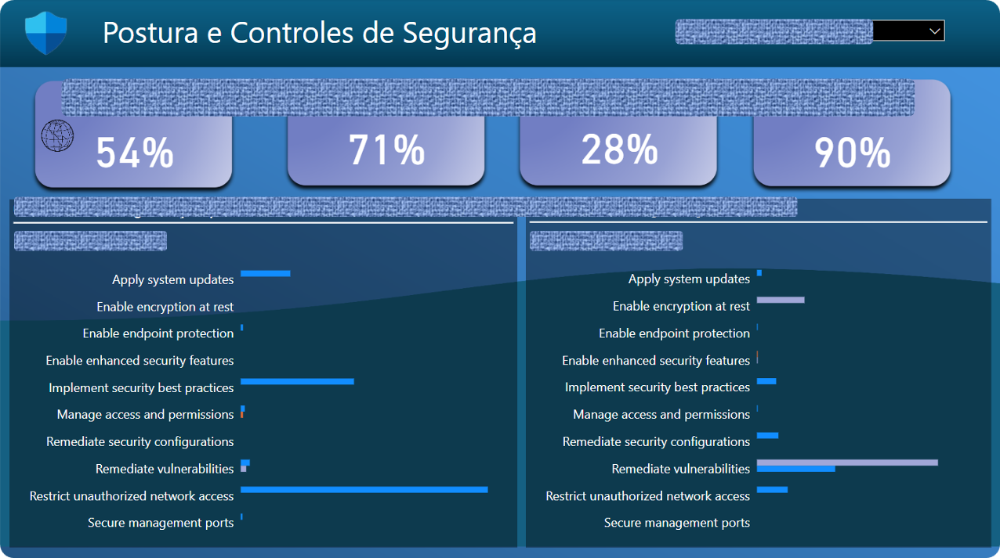
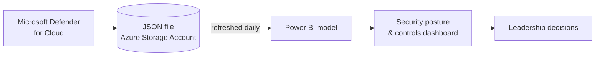
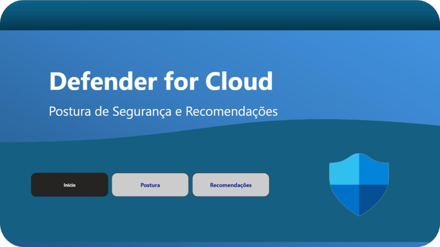
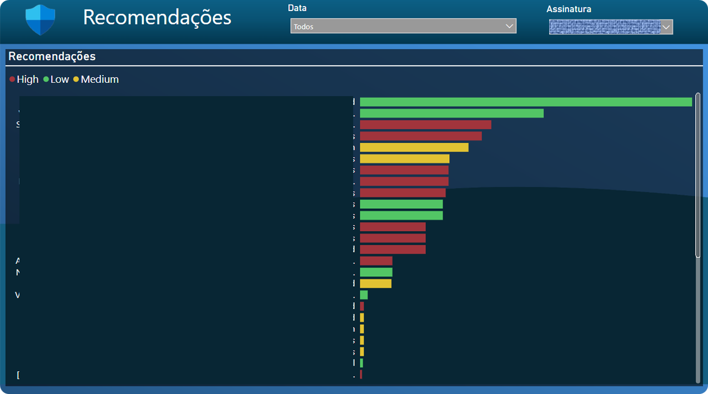

  

  
  
  
  
   
  
  

## 🛡️ Overview

Built to help **Information Security leadership** make strategic decisions with **reliable, up-to-date data about cloud security**.

> 🔒 For confidentiality and information governance, some information in the report was intentionally blurred to avoid any risk of exposing sensitive data.

## 🏗️ How it works

A **JSON** file stored in an **Azure Storage Account** is updated **daily** with new security data, so the dashboard refreshes automatically with the latest information — turning technical security data into strategic insights for leadership.

## 🚀 Results

| | |
|---|---|
| 🩹 **−40%** | vulnerabilities, after surfacing the high volume of required fixes |
| 🔥 **−30%** | high-severity risks after targeted remediation |
| 📈 **+20%** | overall Secure Score, adding resilience to cloud workloads |

## 📸 Dashboard gallery

<table>
  <tr>
    <td width="33%" align="center"> <b>Home</b></td>
    <td width="33%" align="center"> <b>Security posture & controls</b></td>
    <td width="33%" align="center"> <b>Dashboard page</b></td>
  </tr>
</table>

---

🔒 Corporate project: sensitive data was blurred and this repository documents the solution only.  
👤 Part of <a href="https://github.com/MatheusFelipePereira">Matheus Felipe Pereira's portfolio</a> · <a href="https://www.linkedin.com/in/matheus-felipe-p/">LinkedIn</a> · <a href="https://matheusfp300.wixsite.com/dataanalyst">Portfolio site</a>
